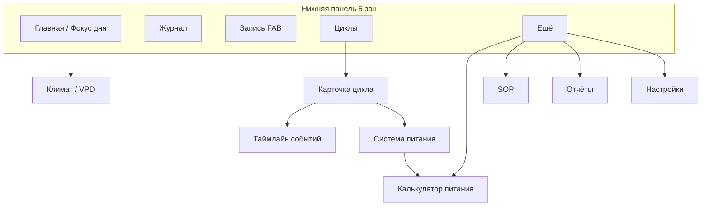

# План редизайна Growlog AI (веб + Expo)

**Статус:** черновик на согласование владельца · **без изменений продакшн-UI**  
**Эталон зрелости:** калькулятор питания (`/nutrient/*`) — токены в `styles/globals.css`, `ScrollableTabs`, `Field`, `NativeSelect`, `Skeleton`, `AppBrandLine`, радиус `0,75rem`, зоны нажатия `44px`, светлая/тёмная тема.  
**Дата:** 23 октября 2026

---

## 1. Цель и границы

Привести остальные поверхности продукта к тому же уровню «коммерческого мобильного приложения 2026–2027», что и калькулятор питания:

| В зоне редизайна | Вне скоупа этого PR |
|------------------|---------------------|
| Главная / Daily Focus (`/dashboard`) | Реализация в продакшн-компонентах |
| Журнал (таймлайн, запись, голос, фото) | Миграции БД |
| Циклы выращивания (хаб + карточка цикла) | Новые бизнес-правила AI |
| Сенсоры и VPD | |
| Настройки, онбординг, вход | |
| Expo mobile (`apps/mobile`) | |

**Принципы (ADR):** факты из БД; русская копия для гроверов; десятичная **запятая** в UI; без жаргона разработчиков в пользовательских текстах.

---

## 2. Эталон: калькулятор питания

Скриншоты «как должно ощущаться»:

| Тема | Файл |
|------|------|
| Светлая | `artifacts/before/nutrient-calculator-light.png` |
| Тёмная | `artifacts/before/nutrient-calculator-dark.png` |

**Что переносим на всё приложение:**

- Шапка: логотип `44×44`, `AppBrandLine`, компактный заголовок, иконки действий `h-11 w-11`.
- Нижняя навигация на мобильной ширине (у калькулятора — отдельная модель; у основного приложения — см. §5).
- Карточки: `rounded-xl` (`--radius: 0.75rem`), тени `--elev-1` / `--elev-2`.
- Формы: `Field` + `NativeSelect`, не «сырые» `<select>` без стиля.
- Переключатели вкладок: `ScrollableTabs` вместо перегруженной верхней панели.
- Скелетоны при загрузке, анимация `fade-in` при смене вкладок.
- Контраст и ботаническая палитра `--grow-*` в светлой и тёмной теме.

---

## 3. Аудит экранов (текущее состояние)

Снимки сняты локально (`pnpm dev` + `scripts/capture-app-redesign-artifacts.sh`), viewport **390×844**, `?lang=ru`. Для защищённых маршрутов без сессии использованы **localhost-only** превью `pages/preview/*`, повторяющие текущую разметку и стили.

### 3.1. Вход (`/auth/login`)


| Проблемы | Предлагаемый layout |
|----------|---------------------|
| Визуально сильнее лендинга, но слабее калькулятора: мелкие контролы, нет единого `Field` | Полноэкранная карточка с `rounded-xl`, поля email/пароль через `Field`, кнопки провайдеров `min-h-11`, тот же `GrowEcoBackdrop` что сейчас, но с сеткой отступов 16/24 |
| Много действий в углу без группировки | Язык и тема — в одной «пилюле» в шапке карточки |

Тёмная тема: `artifacts/before/login-dark.png`.

### 3.2. Онбординг (`/onboarding`)


| Проблемы | Предлагаемый layout |
|----------|---------------------|
| Технические формулировки в описании (ADR-001) | Пошаговый wizard: «Ферма» → «Цикл» → «Готово», простые подсказки |
| Стадия `veg` латиницей | `NativeSelect` с русскими названиями стадий |
| Нет прогресса | Индикатор шага и крупная primary-кнопка `44px` |

### 3.3. Фокус дня / главная (`/dashboard`)


| Проблемы | Предлагаемый layout |
|----------|---------------------|
| Перегруженная шапка: 6+ иконок, мелкий переключатель фермы | Контекст фермы/цикла — одна строка под брендом; сенсоры и настройки — в «Ещё» или иконки `44px` справа |
| Нижний nav: 5 пунктов + отдельный FAB «Запись» — дублирование | Единая нижняя панель: центральная «Запись» (см. макет) |
| Карточки разного визуального веса, типы событий в таймлайне UPPERCASE EN | Иерархия: снимок цикла → риски → SOP → ИИ; русские подписи типов событий |
| VPD «встроен» без общего стиля сенсоров | Компактный климат-блок с запятой в числах |

Макет «после»: `artifacts/mockups/dashboard-light.png` / `dashboard-dark.png`.  
Интерактив: `/preview/mockups/dashboard?lang=ru&appearance=light|dark`.

### 3.4. Журнал — таймлайн (`/timeline`)


| Проблемы | Предлагаемый layout |
|----------|---------------------|
| Список карточек без группировки по дням | Лента с датами-разделителями и вертикальной линией (как в карточке цикла) |
| `event_type` латиницей | Человекочитаемые типы из i18n |
| Нет поиска и фильтра | Строка поиска + `ScrollableTabs` «Лента / Календарь» |

Макет журнала: `artifacts/mockups/journal-*.png`, маршрут `/preview/mockups/journal`.

### 3.5. Журнал — запись (`/log`)


| Проблемы | Предлагаемый layout |
|----------|---------------------|
| Типы событий — мелкие кнопки без единого стиля | Сегментированный `ScrollableTabs` или chip-grid `min-h-11` |
| Техническое описание карточки (`events`, ADR) | Короткая подсказка для гровера |
| Голос вынесен на отдельный flow | На макете журнала — быстрые «Голос / Фото» над полем |

### 3.6. Циклы (сейчас фрагментировано)


| Проблемы | Предлагаемый layout |
|----------|---------------------|
| Нет экрана «Циклы»; данные в настройках и калькуляторе | Вкладка «Циклы» в нижнем меню: список + карточка активного |
| Нет связки таймлайн + `grow_cycle_nutrient_plans` + `farm_feed_systems` | Карточка цикла: вкладки «Обзор / Таймлайн / Питание» |

Макет карточки: `artifacts/mockups/cycle-detail-*.png`, `/preview/mockups/cycle-detail`.  
Данные: `GrowCycle`, `EventRow`, `GrowCycleNutrientPlanRow`, шаги `FarmFeedSystemStepRow` (см. `lib/preview/mock-farm-data.ts`).

### 3.7. Настройки (`/settings`)


| Проблемы | Предлагаемый layout |
|----------|---------------------|
| Стек `Card` без группировки, нативные select | Секции с заголовками iOS-стиля, `Field` / `NativeSelect` |
| «Scope» вместо «Область» в части копира | Единый глоссарий для гровера |
| Цикл только для чтения | Ссылка «Открыть цикл» → хаб циклов |

### 3.8. Сенсоры и VPD (`/sensors`)


| Проблемы | Предлагаемый layout |
|----------|---------------------|
| VPD и ручной замер — разные визуальные языки | Один экран «Климат»: VPD сверху, замеры ниже, устройства — вкладка |
| Форма замера — классические input без `Field` | Те же компоненты, что в калькуляторе |
| Числа с точкой в превью | В проде — `ru-RU` и запятая |

### 3.9. Ассистент, SOP, отчёты, фото (кратко)

Не снимались отдельно в этом PR; по тому же шаблону:

- **Ассистент:** шапка как у главной, пузыри с блоком «факты / уверенность / чего не хватает», поле ввода `min-h-11`.
- **SOP:** список задач как на макете «Регламенты на сегодня» на главной.
- **Отчёты:** карточки-превью, не «редактор».
- **Фото:** сетка с закруглением `0,75rem`, FAB «камера».

### 3.10. Expo mobile (`apps/mobile`)

| Сейчас | Цель |
|--------|------|
| Табы: Focus, Timeline, Mic, SOP, More — хардкод цветов `#1b4332` | Токены из общей темы (CSS variables / NativeWind или theme object) |
| Калькулятор в «More» | Питание — из нижнего меню или быстрый ряд под таб-баром (как в макете) |
| Scope bar отдельно от бренда | Тот же паттерн, что `AppBrandLine` + контекстная строка |

---

## 4. Модель навигации (мобильная ширина)



**Веб (≥768px):** боковая или верхняя навигация с теми же 5 корнями; контент `max-w-lg` на телефоне, `max-w-3xl` на планшете — как у калькулятора (`max-w-lg`) vs текущий `AppShell` (`max-w-3xl`).

**Запись:** центральная кнопка `56×56`, `rounded-2xl`, не конкурирует с отдельным sticky FAB поверх tab-bar.

---

## 5. Общая дизайн-система

| Токен / правило | Светлая | Тёмная | Примечание |
|-----------------|---------|--------|------------|
| `--radius` | `0,75rem` | то же | Кнопки, карточки, инпуты |
| Tap target | `min-h-11 min-w-11` (44px) | то же | WCAG + mobile 2026 |
| `--primary` / `--grow-forest` | ботанический зелёный | осветлённый primary | Уже в `globals.css` |
| Фон | `--background`, `--card` | глубокий `--background` 140 12% 7% | |
| Тень | `--elev-1`, `--elev-2` | усиленные в `.dark` | |
| Motion | `--motion-fast` 150ms, `--motion-base` 220ms | | Переходы вкладок, theme |
| Типографика | Заголовок экрана `text-lg font-semibold`; тело `text-sm`; метки `text-xs` | | Inter/system stack (как сейчас) |
| Числа | `tabular-nums`, локаль `ru-RU`, запятая | | EC 1,6; VPD 1,12 кПа |
| Иконки | `lucide-react` 20–24px в nav, 16px inline | | Expo: SF Symbols / Material через `SymbolView` |

**Тема:** `next-themes` + класс `.dark` на `html` (без смены архитектуры).

---

## 6. Инвентарь компонентов

### Уже есть (расширить использование)

| Компонент | Путь | Куда внедрить |
|-----------|------|----------------|
| `AppBrandLine` | `components/layout/AppBrandLine.tsx` | Все shell вместо голого заголовка |
| `ScrollableTabs` | `components/ui/scrollable-tabs.tsx` | Главная (период), журнал, карточка цикла |
| `Field` | `components/ui/field.tsx` | Лог, сенсоры, настройки, онбординг |
| `NativeSelect` | `components/ui/native-select.tsx` | Настройки, фильтры журнала |
| `Skeleton` | `components/ui/skeleton.tsx` | Daily Focus, таймлайн, списки |
| `Button` variants | `components/ui/button.tsx` | Выравнить размеры `sm` → min 44px на mobile |

### Создать / выделить

| Компонент | Назначение |
|-----------|------------|
| `AppTabBar` | Единая нижняя навигация веб (параметры: active, onNavigate) |
| `ContextScopeLine` | Ферма · цикл · область — одна строка под брендом |
| `EventTypeChip` | Тип события с i18n и цветом категории |
| `TimelineDayGroup` | Группировка `EventRow` по дате |
| `CycleSnapshotCard` | Снимок цикла для главной |
| `SopTaskRow` | Строка регламента с состоянием (готово / просрочено) |
| `InsightCard` | AI-инсайт с confidence и CTA |
| `ClimateSummaryStrip` | VPD + T + RH компактно |
| `MobileScreen` (Expo) | Общая обёртка: safe area + tab bar tokens |

### Макеты (только превью, не прод)

| Файл | Маршрут |
|------|---------|
| `components/design-mockups/DashboardMockup.tsx` | `/preview/mockups/dashboard` |
| `components/design-mockups/JournalMockup.tsx` | `/preview/mockups/journal` |
| `components/design-mockups/CycleDetailMockup.tsx` | `/preview/mockups/cycle-detail` |

---

## 7. Поэтапное внедрение

| Фаза | Область | Результат |
|------|---------|-----------|
| **0** | Токены, `AppTabBar`, `ContextScopeLine` | Общий shell веб + storybook/превью |
| **1** | Главная Daily Focus | Новый layout без смены данных (`FarmProvider`, SOP queries) |
| **2** | Журнал: таймлайн + запись | Единый раздел «Журнал», типы событий RU |
| **3** | Циклы | Список + деталь с таймлайном и вкладкой питания (`grow_cycle_nutrient_plans`) |
| **4** | Сенсоры / VPD | Один экран климата, стили калькулятора |
| **5** | Настройки, онбординг, вход | `Field` / wizard |
| **6** | Expo | Перенос tab bar и темы; выравнивание с веб-навигацией |
| **7** | Ассистент, SOP, отчёты, фото | Вторичные экраны по тому же гайду |

Каждая фаза — отдельный PR, визуальная регрессия через скриншоты превью.

---

## 8. Артефакты в репозитории

### «До» (`docs/design/artifacts/before/`)

- `login-light.png`, `login-dark.png`
- `nutrient-calculator-light.png`, `nutrient-calculator-dark.png`
- `dashboard-light.png`, `dashboard-dark.png`
- `timeline-light.png`, `timeline-dark.png`
- `journal-log-light.png`, `journal-log-dark.png`
- `settings-light.png`
- `sensors-light.png`
- `onboarding-light.png`
- `cycles-fragment-light.png`

### Макеты «после» (`docs/design/artifacts/mockups/`)

- `dashboard-light.png`, `dashboard-dark.png`
- `journal-light.png`, `journal-dark.png`
- `cycle-detail-light.png`, `cycle-detail-dark.png`

**Пересъёмка:**

```bash
pnpm dev
bash scripts/capture-app-redesign-artifacts.sh
```

---

## 9. Решения на согласование

1. **Пять корневых вкладок** (Главная, Журнал, Запись, Циклы, Ещё) — подтвердить вместо текущих Focus / Timeline / AI / SOP / Reports в нижней панели.
2. **Ассистент:** остаётся отдельным экраном из «Ещё» или возвращается в tab-bar (сейчас в макете — через кнопку на главной).
3. **Ширина контента:** выровнять основное приложение на `max-w-lg` как калькулятор или оставить `max-w-3xl` на планшете.
4. **Термин «область»** vs «зона» vs «scope» в UI — зафиксировать глоссарий.

---

## 10. Следующий шаг после одобрения

1. Владелец отмечает правки по макетам (Figma не обязателен — достаточно комментариев к PNG / превью URL).
2. Фаза 0: вынести `AppTabBar` и обновить `AppShell` без изменения маршрутов.
3. Параллельно: задачи в бэклоге на Expo theme parity.

*Документ подготовлен Cloud Agent; код макетов не подключён к продакшн-роутам.*
