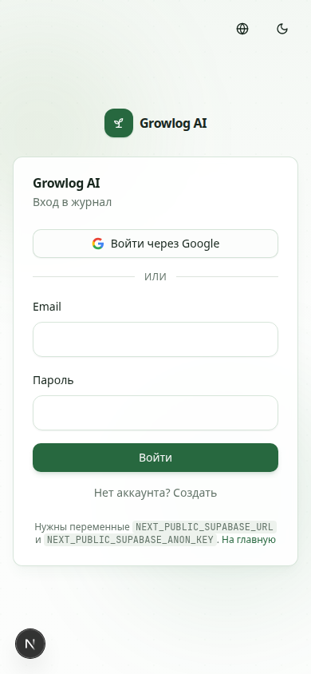
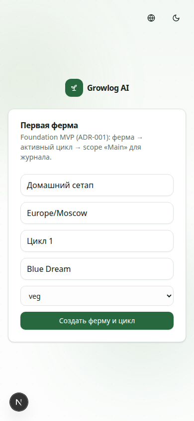
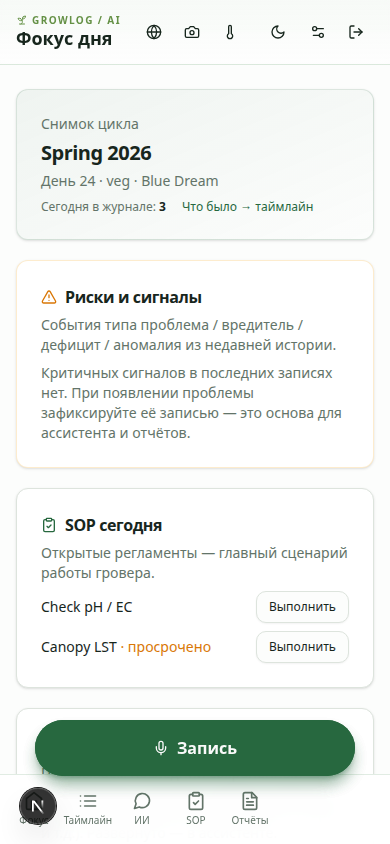
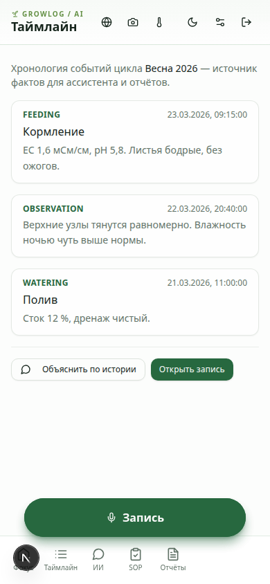
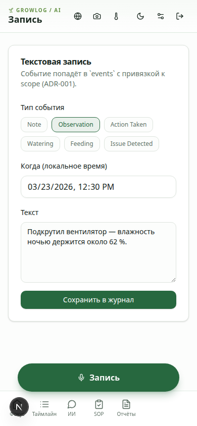
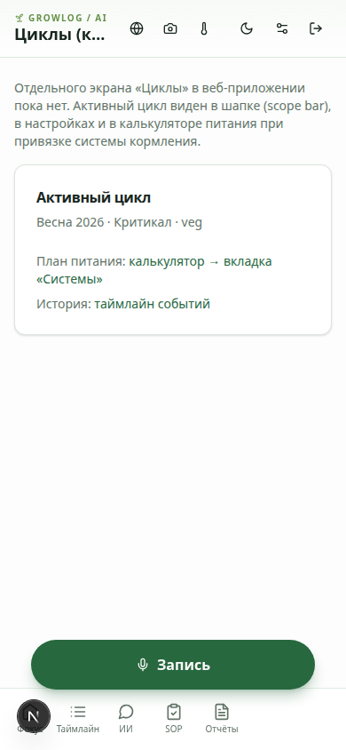
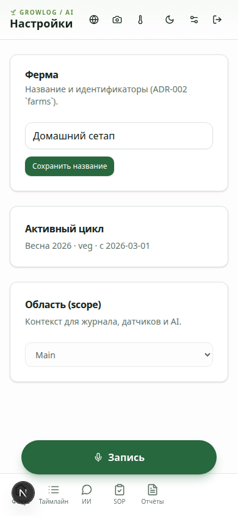
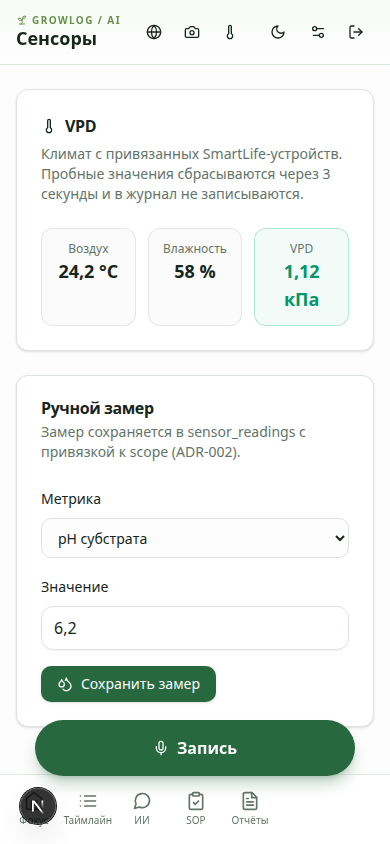
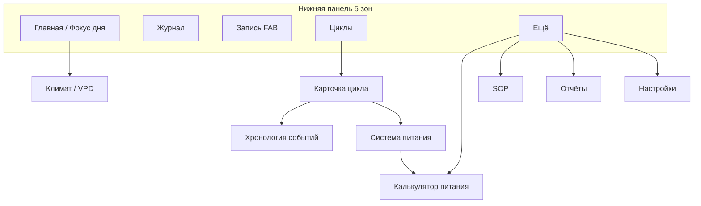

# План редизайна Growlog AI (веб + Expo)

**Статус:** направление **согласовано владельцем** (октябрь 2026); в PR — уточнённые макеты и копирайт · **без изменений продакшн-UI**  
**Эталон зрелости:** калькулятор питания (`/nutrient/*`) — токены в `styles/globals.css`, `ScrollableTabs`, `Field`, `NativeSelect`, `Skeleton`, `AppBrandLine`, радиус `0,75rem`, зоны нажатия `44px`, светлая/тёмная тема.  
**Дата:** 23 октября 2026

---

## 1. Цель и границы

Привести остальные поверхности продукта к тому же уровню «коммерческого мобильного приложения 2026–2027», что и калькулятор питания:

| В зоне редизайна | Вне скоупа этого PR |
|------------------|---------------------|
| Главная / Daily Focus (`/dashboard`) | Реализация в продакшн-компонентах |
| Журнал (таймлайн, запись, голос, фото) | Миграции БД |
| Циклы выращивания (хаб + карточка цикла) | Новые бизнес-правила AI |
| Сенсоры и VPD | |
| Настройки, онбординг, вход | |
| Expo mobile (`apps/mobile`) | |

**Принципы (ADR):** факты из БД; русская копия для гроверов; десятичная **запятая** в UI; без жаргона разработчиков в пользовательских текстах.

### Копирайт в макетах (согласовано)

| Было / нельзя | В макетах |
|---------------|-----------|
| Timeline, Main, scope в UI | **Хронология** (вкладка цикла), **Гроубокс 1** (пример области) |
| Стрелки `→`, «vs» | «с 58 до 65 %», «2 из 3» |
| LST, SOP в пользовательском тексте | «формировка кроны», «задачи / регламенты» (латиница только где принято: pH, EC, Coco **A+B**) |
| `GROWLOG / AI`, ALL CAPS | Строка бренда **`Growlog • OG Lab`** (точный регистр) + заголовок экрана |
| VPD как жаргон без контекста | «Дефицит влаги (VPD)» с единицами **кПа** |

Нижняя панель на **всех** мобильных макетах: 5 вкладок + центральная **Запись** (`44–56px`), `env(safe-area-inset-bottom)`; контент с отступом `pb`, чтобы не уходить под панель. Скриншоты без индикатора Next.js (`HideNextDevIndicator` на превью).

---

## Сохраняем без изменений поведения

Виджет **VPD (SmartLife)** уже в проде на `main` — его **не переписываем**, только **перестиливаем** оболочку вокруг того же компонента.

| Что остаётся как есть | Где в коде |
|----------------------|------------|
| Загрузка точек климата с устройств Tuya / SmartLife | `components/sensors/useVpdClimate.ts`, API устройств |
| Расчёт VPD, полоса по стадии цикла | `@growlog/domain` (`vpd.ts`), `useVpdClimate` |
| **Тап** по температуре воздуха / листа / влажности — ввод **пробного** значения, пересчёт VPD на экране | `VpdWidget` → `MetricCell`, `onPreviewCommit` / `onPreviewFocus` |
| Пробные значения **сбрасываются ~через 3 с**, в `sensor_readings` и журнал **не пишутся** | `useVpdClimate` (таймер сброса), копирайт `vpd.desc` |
| Бейдж **«Проба»** при активном превью | `climate.isPreview` в `VpdWidget` |
| **Долгое нажатие** (~500 ms) или контекстное меню — **выбор датчика** (воздух / лист / влажность), списки устройств | `startLongPress`, `Popover` + `renderPickerList` в `VpdWidget` |
| Точки входа: **Фокус дня** и экран **Сенсоры** | `DailyFocus`, `pages/sensors.tsx` |

**В редизайне:** на главной и в карточке цикла — компактный **чип VPD** (тап открывает тот же полноразмерный `VpdWidget`, например в листе или на экране климата). Логика long-press / preview-only **не дублируется** в новых компонентах.

**Макеты (статика, поведение как на проде):**

| Состояние | PNG | Превью |
|-----------|-----|--------|
| Виджет развёрнут, режим «Проба» | `vpd-expanded-light.png`, `vpd-expanded-dark.png` | `/preview/mockups/vpd-expanded` |
| Лист выбора датчика влажности | `vpd-sensor-picker-light.png`, `vpd-sensor-picker-dark.png` | `/preview/mockups/vpd-sensor-picker` |

---

## 2. Эталон: калькулятор питания

Скриншоты «как должно ощущаться»:

| Тема | Файл |
|------|------|
| Светлая | `artifacts/before/nutrient-calculator-light.png` |
| Тёмная | `artifacts/before/nutrient-calculator-dark.png` |

**Что переносим на всё приложение:**

- Шапка: иконка `44×44`, строка бренда **`Growlog • OG Lab`**, компактный заголовок, иконки действий `h-11 w-11`.
- Нижняя навигация на мобильной ширине (у калькулятора — отдельная модель; у основного приложения — см. §5).
- Карточки: `rounded-xl` (`--radius: 0.75rem`), тени `--elev-1` / `--elev-2`.
- Формы: `Field` + `NativeSelect`, не «сырые» `<select>` без стиля.
- Переключатели вкладок: `ScrollableTabs` вместо перегруженной верхней панели.
- Скелетоны при загрузке, анимация `fade-in` при смене вкладок.
- Контраст и ботаническая палитра `--grow-*` в светлой и тёмной теме.

---

## 3. Аудит экранов (текущее состояние)

Снимки сняты локально (`pnpm dev` + `scripts/capture-app-redesign-artifacts.sh`), viewport **390×844**, `?lang=ru`. Для защищённых маршрутов без сессии использованы **localhost-only** превью `pages/preview/*`, повторяющие текущую разметку и стили.

### 3.1. Вход (`/auth/login`)



| Проблемы | Предлагаемый layout |
|----------|---------------------|
| Визуально сильнее лендинга, но слабее калькулятора: мелкие контролы, нет единого `Field` | Полноэкранная карточка с `rounded-xl`, поля email/пароль через `Field`, кнопки провайдеров `min-h-11`, тот же `GrowEcoBackdrop` что сейчас, но с сеткой отступов 16/24 |
| Много действий в углу без группировки | Язык и тема — в одной «пилюле» в шапке карточки |

Тёмная тема: `artifacts/before/login-dark.png`.

### 3.2. Онбординг (`/onboarding`)



| Проблемы | Предлагаемый layout |
|----------|---------------------|
| Технические формулировки в описании (ADR-001) | Пошаговый wizard: «Ферма» → «Цикл» → «Готово», простые подсказки |
| Стадия `veg` латиницей | `NativeSelect` с русскими названиями стадий |
| Нет прогресса | Индикатор шага и крупная primary-кнопка `44px` |

### 3.3. Фокус дня / главная (`/dashboard`)



| Проблемы | Предлагаемый layout |
|----------|---------------------|
| Перегруженная шапка: 6+ иконок, мелкий переключатель фермы | Контекст фермы/цикла — одна строка под брендом; сенсоры и настройки — в «Ещё» или иконки `44px` справа |
| Нижний nav: 5 пунктов + отдельный FAB «Запись» — дублирование | Единая нижняя панель: центральная «Запись» (см. макет) |
| Карточки разного визуального веса, типы событий в таймлайне UPPERCASE EN | Иерархия: снимок цикла → риски → SOP → ИИ; русские подписи типов событий |
| VPD «встроен» без общего стиля сенсоров | Компактный климат-блок с запятой в числах |

Макет «после»: `artifacts/mockups/dashboard-light.png` / `dashboard-dark.png`.  
Интерактив: `/preview/mockups/dashboard?lang=ru&appearance=light|dark`.

### 3.4. Журнал — таймлайн (`/timeline`)



| Проблемы | Предлагаемый layout |
|----------|---------------------|
| Список карточек без группировки по дням | Лента с датами-разделителями и вертикальной линией (как в карточке цикла) |
| `event_type` латиницей | Человекочитаемые типы из i18n |
| Нет поиска и фильтра | Строка поиска + `ScrollableTabs` «Лента / Календарь» |

Макет журнала: `artifacts/mockups/journal-*.png`, маршрут `/preview/mockups/journal`.

### 3.5. Журнал — запись (`/log`)



| Проблемы | Предлагаемый layout |
|----------|---------------------|
| Типы событий — мелкие кнопки без единого стиля | Сегментированный `ScrollableTabs` или chip-grid `min-h-11` |
| Техническое описание карточки (`events`, ADR) | Короткая подсказка для гровера |
| Голос вынесен на отдельный flow | На макете журнала — быстрые «Голос / Фото» над полем |

### 3.6. Циклы (сейчас фрагментировано)



| Проблемы | Предлагаемый layout |
|----------|---------------------|
| Нет экрана «Циклы»; данные в настройках и калькуляторе | Вкладка «Циклы» в нижнем меню: список + карточка активного |
| Нет связки хронологии + планов питания | Экран цикла: компактная шапка (**Сорт …**, «Вегетация · день N», бейдж **Активен**; без карточки и без партии в шапке); sticky-вкладки «Обзор / Хронология / Питание»; обзор — EC/pH, VPD, питание Coco A+B |

Макеты:

- Список циклов: `cycles-list-*.png` → `/preview/mockups/cycles-list`
- Карточка, обзор: `cycle-detail-*.png` → `/preview/mockups/cycle-detail`
- Карточка, хронология (кормления): `cycle-detail-chronology-*.png` → `?section=chronology`
- Лист «Запись»: `capture-sheet-*.png` → `/preview/mockups/capture-sheet`

Данные: `GrowCycle`, `EventRow`, `GrowCycleNutrientPlanRow`, шаги `FarmFeedSystemStepRow` (см. `lib/preview/mock-farm-data.ts`).

### 3.7. Настройки (`/settings`)



| Проблемы | Предлагаемый layout |
|----------|---------------------|
| Стек `Card` без группировки, нативные select | Секции с заголовками iOS-стиля, `Field` / `NativeSelect` |
| «Scope» вместо «Область» в части копира | Единый глоссарий для гровера |
| Цикл только для чтения | Ссылка «Открыть цикл» → хаб циклов |

### 3.8. Сенсоры и VPD (`/sensors`)



| Проблемы | Предлагаемый layout |
|----------|---------------------|
| VPD и ручной замер — разные визуальные языки | Один экран «Климат»: VPD сверху, замеры ниже, устройства — вкладка |
| Форма замера — классические input без `Field` | Те же компоненты, что в калькуляторе |
| Числа с точкой в превью | В проде — `ru-RU` и запятая |

### 3.9. Ассистент, SOP, отчёты, фото (кратко)

Не снимались отдельно в этом PR; по тому же шаблону:

- **Ассистент:** шапка как у главной, пузыри с блоком «факты / уверенность / чего не хватает», поле ввода `min-h-11`.
- **SOP:** список задач как на макете «Регламенты на сегодня» на главной.
- **Отчёты:** карточки-превью, не «редактор».
- **Фото:** сетка с закруглением `0,75rem`, FAB «камера».

### 3.10. Expo mobile (`apps/mobile`)

| Сейчас | Цель |
|--------|------|
| Табы: Focus, Timeline, Mic, SOP, More — хардкод цветов `#1b4332` | Токены из общей темы (CSS variables / NativeWind или theme object) |
| Калькулятор в «More» | Питание — из нижнего меню или быстрый ряд под таб-баром (как в макете) |
| Scope bar отдельно от бренда | Тот же паттерн, что `AppBrandLine` + контекстная строка |

---

## 4. Модель навигации (мобильная ширина)



**Веб (≥768px):** боковая или верхняя навигация с теми же 5 корнями; контент `max-w-lg` на телефоне, `max-w-3xl` на планшете — как у калькулятора (`max-w-lg`) vs текущий `AppShell` (`max-w-3xl`).

**Запись:** центральная кнопка `56×56`, `rounded-2xl`, не конкурирует с отдельным sticky FAB поверх tab-bar.

---

## 5. Общая дизайн-система

| Токен / правило | Светлая | Тёмная | Примечание |
|-----------------|---------|--------|------------|
| `--radius` | `0,75rem` | то же | Кнопки, карточки, инпуты |
| Tap target | `min-h-11 min-w-11` (44px) | то же | WCAG + mobile 2026 |
| `--primary` / `--grow-forest` | ботанический зелёный | осветлённый primary | Уже в `globals.css` |
| Фон | `--background`, `--card` | глубокий `--background` 140 12% 7% | |
| Тень | `--elev-1`, `--elev-2` | усиленные в `.dark` | |
| Motion | `--motion-fast` 150ms, `--motion-base` 220ms | | Переходы вкладок, theme |
| Типографика | Заголовок экрана `text-lg font-semibold`; тело `text-sm`; метки `text-xs` | | Inter/system stack (как сейчас) |
| Числа | `tabular-nums`, локаль `ru-RU`, запятая | | EC 1,6; VPD 1,12 кПа |
| Иконки | `lucide-react` 20–24px в nav, 16px inline | | Expo: SF Symbols / Material через `SymbolView` |

**Тема:** `next-themes` + класс `.dark` на `html` (без смены архитектуры).

---

## 6. Инвентарь компонентов

### Уже есть (расширить использование)

| Компонент | Путь | Куда внедрить |
|-----------|------|----------------|
| `AppBrandLine` / бренд | `AppBrandLine.tsx` → текст **`Growlog • OG Lab`** в новом shell | Макеты: `MockupBrandLine.tsx` |
| `ScrollableTabs` | `components/ui/scrollable-tabs.tsx` | Главная (период), журнал, карточка цикла |
| `Field` | `components/ui/field.tsx` | Лог, сенсоры, настройки, онбординг |
| `NativeSelect` | `components/ui/native-select.tsx` | Настройки, фильтры журнала |
| `Skeleton` | `components/ui/skeleton.tsx` | Daily Focus, таймлайн, списки |
| `Button` variants | `components/ui/button.tsx` | Выравнить размеры `sm` → min 44px на mobile |

### Создать / выделить

| Компонент | Назначение |
|-----------|------------|
| `AppTabBar` | Единая нижняя навигация веб (параметры: active, onNavigate) |
| `ContextScopeLine` | Ферма · цикл · область — одна строка под брендом |
| `EventTypeChip` | Тип события с i18n и цветом категории |
| `TimelineDayGroup` | Группировка `EventRow` по дате |
| `CycleSnapshotCard` | Снимок цикла для главной |
| `SopTaskRow` | Круглый чекбокс слева (`44px`), strike при выполнении; просрочка — иконка часов/предупреждения + `aria-label`, без текста «просрочено»; счётчик кольцом прогресса |
| `InsightCard` | AI-инсайт с confidence и CTA |
| `ClimateSummaryStrip` | VPD + T + RH компактно |
| `MobileScreen` (Expo) | Общая обёртка: safe area + tab bar tokens |

### Макеты (только превью, не прод)

| Файл | Маршрут |
|------|---------|
| `DashboardMockup.tsx` | `/preview/mockups/dashboard` |
| `JournalMockup.tsx` | `/preview/mockups/journal` |
| `CycleDetailMockup.tsx` | `/preview/mockups/cycle-detail` (+ `?section=chronology`) |
| `CyclesListMockup.tsx` | `/preview/mockups/cycles-list` |
| `CaptureSheetMockup.tsx` | `/preview/mockups/capture-sheet` |
| `VpdExpandedMockup.tsx` | `/preview/mockups/vpd-expanded` |
| `VpdSensorPickerMockup.tsx` | `/preview/mockups/vpd-sensor-picker` |
| `MockupAppShell.tsx` | Общая шапка, контекст, tab bar + safe area |
| `VpdWidget` (прод) | `components/sensors/VpdWidget.tsx` — только стили оболочки |

---

## 7. Поэтапное внедрение

| Фаза | Область | Результат |
|------|---------|-----------|
| **1** | Tab bar + главная + карточка цикла | См. §7.1 — **следующий кодовый PR** |
| **2** | Журнал: лента, запись, лист «Запись» | По макетам `journal-*`, `capture-sheet-*` |
| **3** | Список циклов, климат-экран | `cycles-list-*`; объединение сенсоров и VPD |
| **4** | Настройки, онбординг, вход | `Field` / wizard |
| **5** | Expo | Tab bar, бренд, safe area |
| **6** | Ассистент, регламенты, отчёты, фото | Вторичные экраны |

Каждая фаза — отдельный PR; для фазы 1 эталон — PNG в `artifacts/mockups/`.

### 7.1. Фаза 1 — точный объём реализации (после merge плана)

**Цель:** в проде на мобильной ширине (`< md`) получить shell и два ключевых экрана как в макетах, **без** смены доменной логики и **без** переписывания `VpdWidget`.

#### Входит в фазу 1

| Блок | Требование | Опора на код / макет |
|------|------------|----------------------|
| **Бренд в шапке** | Строка **`Growlog • OG Lab`** (не uppercase), иконка ростка, под ней заголовок экрана и контекст «ферма · цикл · гроубокс» | `MockupBrandLine`, `MockupContextLine` → прод: расширить `AppBrandLine` или i18n `appNameShort` |
| **Нижняя панель** | 5 вкладок: **Главная**, **Журнал**, **Запись** (центр, `56px`, `Plus`), **Циклы**, **Ещё**; `safe-area-inset-bottom`; контент с `padding-bottom` под панель | `components/layout/AppTabBar.tsx` (новый), встроить в `AppShell` вместо текущего горизонтального nav + отдельного `CaptureFab` на этих breakpoints |
| **Маршруты вкладок** | Главная → `/dashboard`; Журнал → `/timeline` (визуал позже, фаза 2); Циклы → новый маршрут детали активного цикла; Ещё → существующее меню/ссылки (`/settings`, питание, регламенты); центр **Запись** → существующий `/log` (или bottom sheet-обёртка без смены `createLogEntry`) | Не ломать `AppRouteReady`, RLS, `farm_id` / `cycle_id` |
| **Главная / Daily Focus** | Layout как `dashboard-*.png`: снимок цикла; **чип VPD**; предупреждение; **задачи на сегодня** — чекбокс слева (toggle SOP run), просрочка иконкой, прогресс «2 из 3»; советник; быстрые действия | `DailyFocus.tsx`, `fetchOpenSopRuns` — без кнопок «Выполнить» |
| **Чип VPD** | Тап открывает **существующий** `VpdWidget` (лист / модал / раскрытие на странице) — preview 3 с, long-press датчики **без изменений** | `components/sensors/VpdWidget.tsx`, `useVpdClimate.ts` — только CSS оболочки чипа |
| **Экран цикла** | Компактная шапка **без карточки**: крупный заголовок «Сорт …», подзаголовок «Стадия · день N» и бейдж **Активен** в одну строку; название цикла («Весна 2026») и гроубокс — мелкой строкой под брендом; **партия / batch** не в шапке (только в «Ещё» / деталях цикла). Вкладки **Обзор / Хронология / Питание** — `ScrollableTabs` **sticky** под шапкой на всех вкладках. Обзор — мини-графики EC/pH, VPD-чип, питание, CTA в калькулятор | `cycle-detail-*.png`, `grow_cycles`, `events`, nutrient plan mutations |
| **Стили** | Токены `globals.css`, `rounded-xl`, `min-h-11`, light/dark | Как калькулятор |

#### Не входит в фазу 1 (следующие фазы)

- Полный редизайн журнала (чипы фильтров, группировка по дням, превью фото).
- Лист быстрой записи как отдельный UI (макет `capture-sheet-*`) — достаточно перехода на `/log`.
- Список всех циклов (`cycles-list-*`) — только деталь активного цикла с вкладки «Циклы».
- Expo, онбординг, вход, ассистент, отчёты.
- Замена логики SmartLife / Tuya или расчёта VPD.

#### Критерии приёмки фазы 1

1. На viewport 390px нижняя панель видна на `/dashboard` и экране цикла; ничего не обрезается под FAB.
2. В шапке отображается **`Growlog • OG Lab`**.
3. Daily Focus визуально соответствует `dashboard-light.png` / `dashboard-dark.png` (допустимы отличия в текстах при пустых данных).
4. Экран цикла соответствует `cycle-detail-light.png`; хронология показывает реальные `events` с типами на русском.
5. Регрессия VPD: тап/долгое нажатие на виджете после открытия с чипа работает как на `main` до редизайна.

#### Ориентир по файлам (черновик)

- `components/layout/AppTabBar.tsx`, `components/layout/AppShell.tsx`
- `components/layout/AppBrandLine.tsx` (или новый ключ i18n)
- `components/daily-focus/DailyFocus.tsx`
- `pages/cycles/[id].tsx` (или эквивалент) + `components/cycles/CycleDetailView.tsx`
- Тесты: smoke на tab routes; unit на отсутствие импорта дублирующей VPD-логики

---

## 8. Артефакты в репозитории

### «До» (`docs/design/artifacts/before/`)

- `login-light.png`, `login-dark.png`
- `nutrient-calculator-light.png`, `nutrient-calculator-dark.png`
- `dashboard-light.png`, `dashboard-dark.png`
- `timeline-light.png`, `timeline-dark.png`
- `journal-log-light.png`, `journal-log-dark.png`
- `settings-light.png`
- `sensors-light.png`
- `onboarding-light.png`
- `cycles-fragment-light.png`

### Макеты «после» (`docs/design/artifacts/mockups/`, 390×844)

- `dashboard-light.png`, `dashboard-dark.png`
- `journal-light.png`, `journal-dark.png`
- `cycle-detail-light.png`, `cycle-detail-dark.png` (вкладка «Обзор»)
- `cycle-detail-chronology-light.png`, `cycle-detail-chronology-dark.png`
- `cycles-list-light.png`, `cycles-list-dark.png`
- `capture-sheet-light.png`, `capture-sheet-dark.png`
- `vpd-expanded-light.png`, `vpd-expanded-dark.png`
- `vpd-sensor-picker-light.png`, `vpd-sensor-picker-dark.png`

**Пересъёмка:**

```bash
pnpm dev
bash scripts/capture-app-redesign-artifacts.sh
```

---

## 9. Решения (зафиксировано / открыто)

**Согласовано:** пять вкладок + центральная «Запись»; уровень UI как у калькулятора; русская копия в макетах; хронология вместо «таймлайн» в UI.

**На финализацию перед фазой 0:**

1. **Ассистент:** экран из «Ещё» vs отдельная вкладка (в макете — кнопка «Спросить советника» на главной).
2. **Ширина контента:** `max-w-lg` как калькулятор или `max-w-3xl` на планшете.
3. **Глоссарий:** «гроубокс / тент / зона» для `scope.display_name`.

---

## 10. Следующий шаг после одобрения

1. Владелец отмечает правки по макетам (Figma не обязателен — достаточно комментариев к PNG / превью URL).
2. Фаза 0: вынести `AppTabBar` и обновить `AppShell` без изменения маршрутов.
3. Параллельно: задачи в бэклоге на Expo theme parity.

*Документ подготовлен Cloud Agent; код макетов не подключён к продакшн-роутам.*
